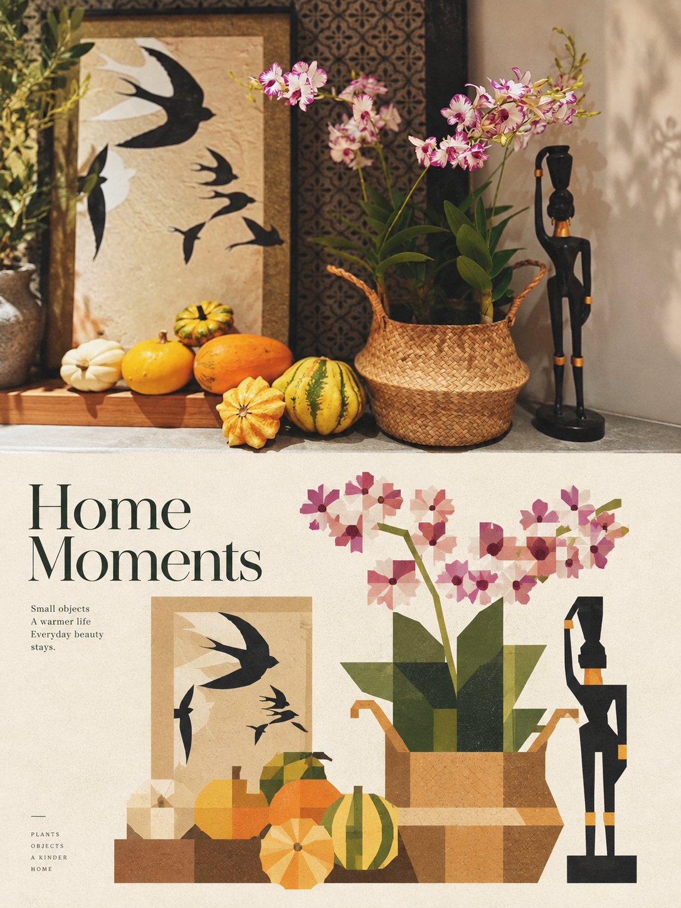
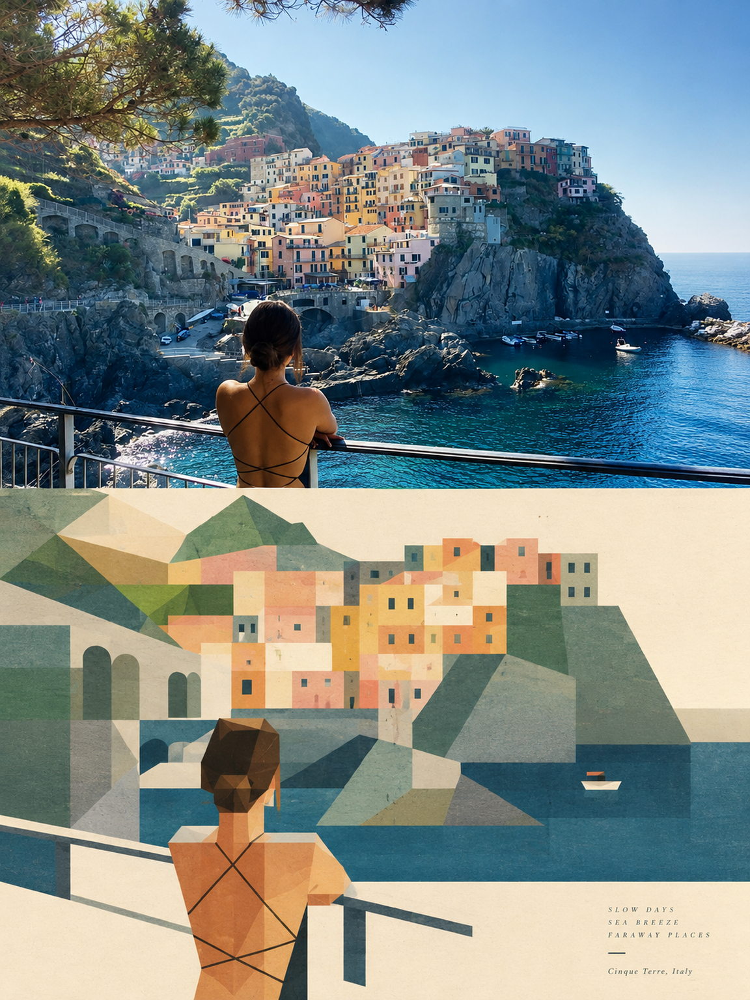
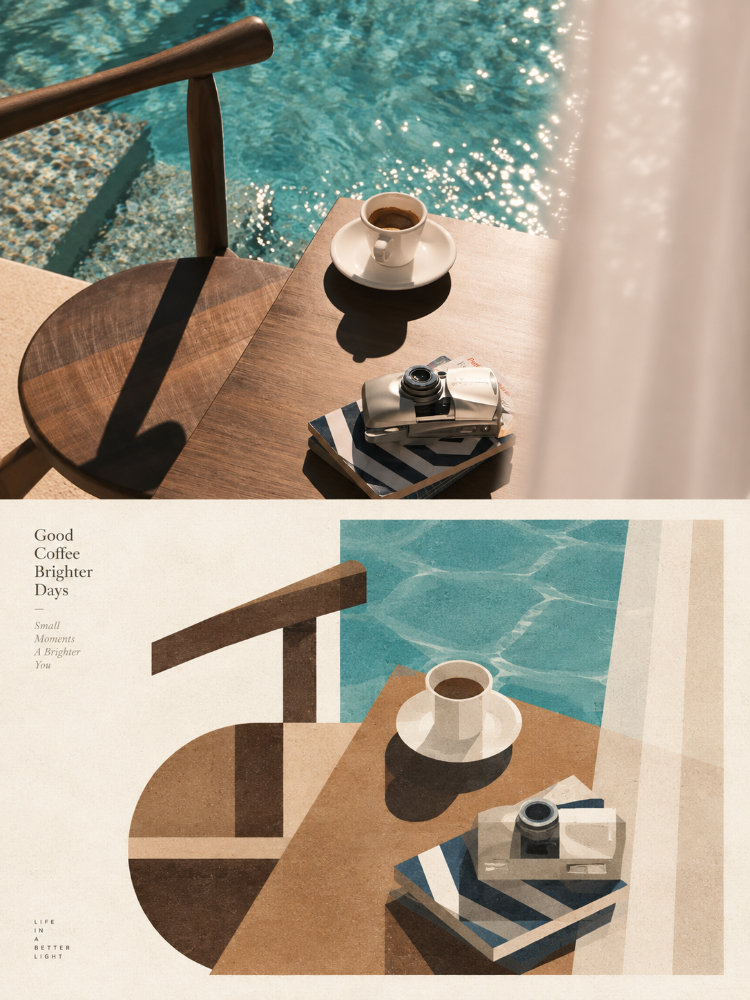
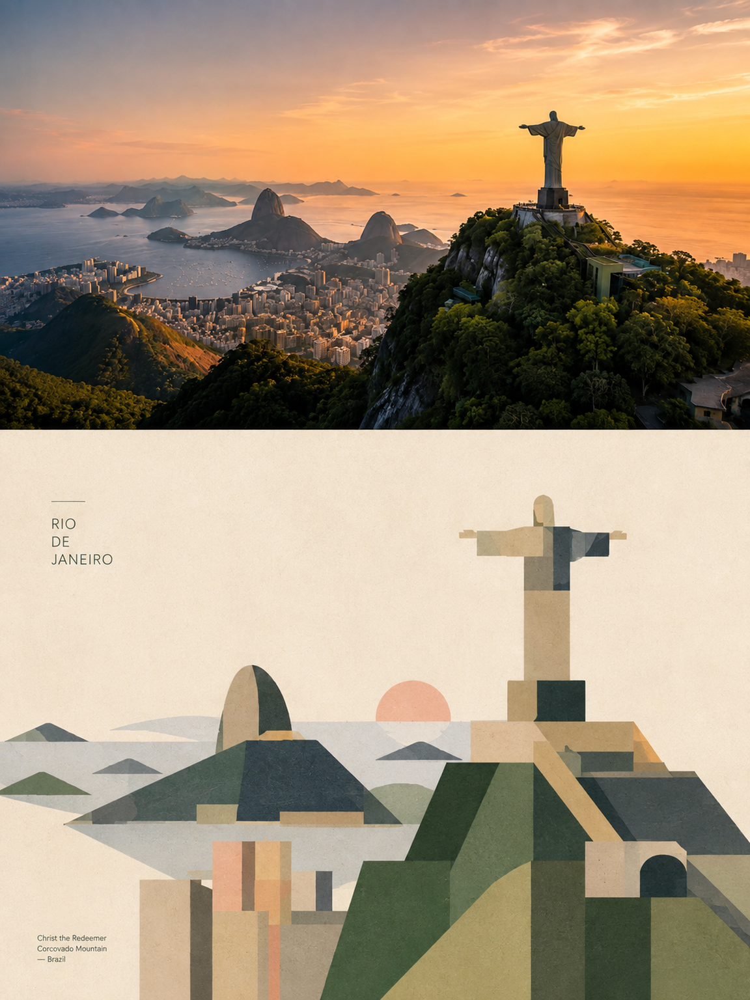
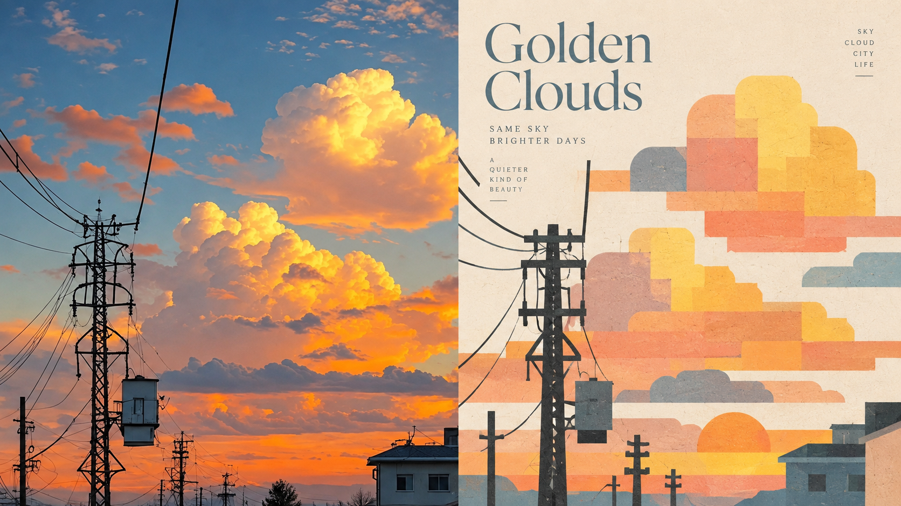
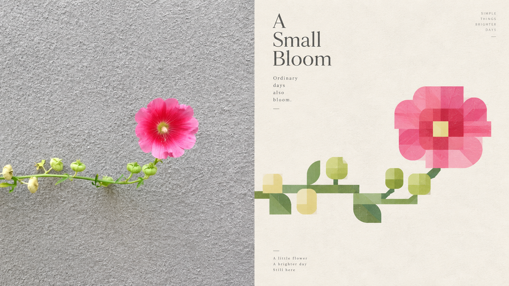
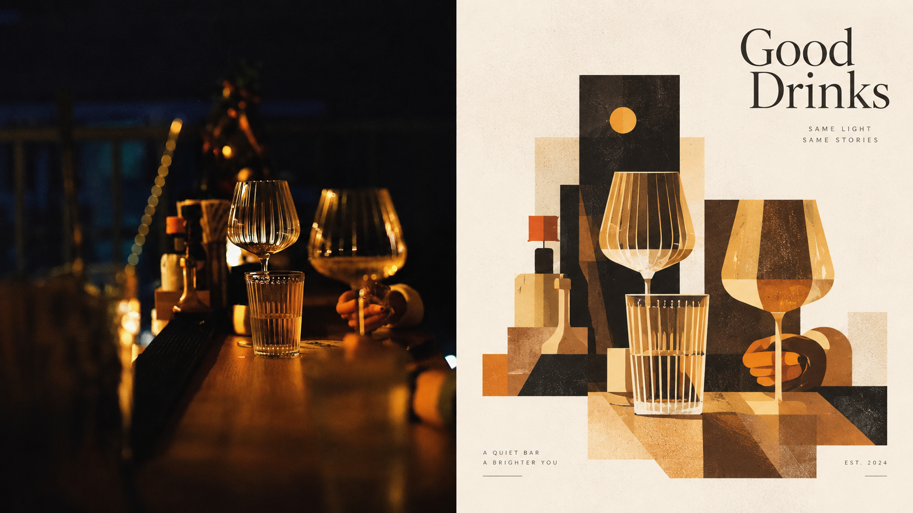
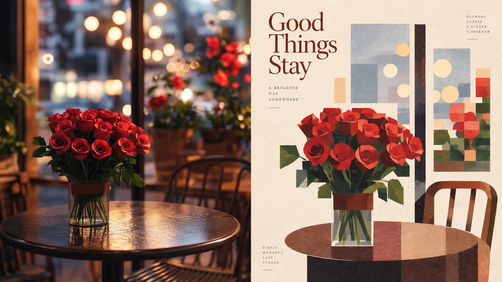

<div align="center">

# XXD Panel 109｜柔和几何解构志

**把照片拆成几块完整的大方块，再用柔和的颜色拼回一个好认的形象。**

<strong>简体中文</strong> · <a href="README.en.md">English</a> · <a href="README.ja.md">日本語</a> · <a href="README.ko.md">한국어</a> · <a href="README.ar.md">العربية</a>

</div>

<table>
  <tr>
    <td width="50%"></td>
    <td width="50%"></td>
  </tr>
</table>

<p align="center"><sub>上半是原照片，下半是这个风格画出来的样子。</sub></p>

## 这是什么

一个给 AI Agent（Claude Code、Codex 等）用的 Skill。你给它一张照片，它按 Panel 109 的原始提示词画出一张 PNG 成品。

- **画成什么样：** 主体用更少、更大、更完整的矩形、方块、圆角方块、椭圆和三角形重新拼出来，不切成零碎小块。人物会有方形脸、清楚的下颌线和块面五官，建筑变成方整体量、立面分区和窗洞节奏，动物、植物、器物也都有方块秩序。色块像纸片一样拼接，主体尺度小，偏心、贴边或局部裁切，四周大片留白。表面有温和的纸张颗粒和一点版画印刷感。颜色是从照片取的二到四种，调成奶油白、杏色、蜜桃粉、雾蓝、鼠尾草绿、暖棕这类柔和色。文字只有小小的标题、注释或编号。
- **关键词：** 大块面模块 · 几何拆分 · 柔和配色 · 纸本颗粒 · 现代主义拼贴 · 编辑留白
- **能出哪些图：** 上下对照（上原图、下设计）、左右对照、只要设计图，或一套手机／平板／电脑／手表壁纸。可以多选，比例和像素随你定。
- **不是什么：** 不是滤镜，也不是套模板：每张都从你的照片重新画，一张照片一个独立任务。

## 三步用起来

**1. 安装。** Claude Code、Codex 等支持 Skills 的 Agent 都能用：

```bash
npx skills add https://github.com/nevertoday/xxd-panel-109 --skill xxd-panel-109
```

装完重开一次 Agent 会话。也可以 `git clone` 本仓库，再把目录链接到 `~/.claude/skills/xxd-panel-109` 或 `~/.codex/skills/xxd-panel-109`。

**2. 确认 Agent 能生图。** 这个 Skill 不自带生图模型，用的是你 Agent 的生图能力，首选 GPT Image 2。

- Codex 开着内置生图时直接能用。
- Claude Code 等没有内置生图的 Agent，需要接一个 OpenAI 兼容的生图接口，五分钟配好，见[没有内置生图怎么配](#没有内置生图怎么配)。

不确定也可以直接用。不能生图时 Skill 会先停下来告诉你，不会白跑。

**3. 发照片，说一句话：**

> 用 xxd-panel-109 把这张照片做成 3:4 上下对照海报，配中文标题。

说清楚了就直接出图；没说到的（版式、比例、文字）它会问你，通常一两个问题。成品是 PNG，放在 `~/Desktop/xxd/xxd-panel-109/` 下本次任务的新文件夹里。

## 什么照片效果好

**效果好**

- 轮廓方正、结构清楚的主体：一栋楼、一辆公交车、一把椅子、一台收音机
- 五官和发型有特点的人像：短发的侧脸、戴眼镜的人、戴帽子的人
- 颜色柔和、能挑出两三种代表色的照片：杏色墙、绿植、蓝色门

**不太合适**

- 以曲线、纹理和细节为主的照片：花丛特写、毛发、蕾丝、水面倒影
- 人多、物多的场景，会被压缩成一个小主体
- 想要写实描摹、细碎拼贴、卡通或 3D 效果的需求

## 样张

下面每张都是这个 Skill 用一张照片生成的成品。上下对照和左右对照用的是不同的照片。

### 上下对照：上原照片，下设计

<table>
  <tr>
    <td width="50%"></td>
    <td width="50%"></td>
  </tr>
  <tr>
    <td width="50%"></td>
    <td width="50%"></td>
  </tr>
</table>

### 左右对照：左原照片，右设计

<table>
  <tr>
    <td width="50%"></td>
    <td width="50%"></td>
  </tr>
  <tr>
    <td width="50%"></td>
    <td width="50%"></td>
  </tr>
</table>

## 常用说法

不用记参数，直接说就行：

| 你想要 | 直接这样说 |
|---|---|
| 上下对照 | 做成 3:4 上下对照 |
| 左右对照 | 做成 16:9 左右对照，左边放原图 |
| 只要设计图 | 只要设计，不要原图，9:16 竖版 |
| 一套壁纸 | 做一套手机、平板、电脑、手表壁纸，风格连起来 |
| 一次多种比例 | 同一张做 1:1、3:4、16:9 各一张 |
| 用自己的文字 | 标题就写「让风经过这里」，一个字都别改 |
| 不要文字 | 不要任何文字 |
| 指定文字语言 | 文字用日语 |
| 整个文件夹 | 把这个文件夹里的照片都做成上下对照 |
| 沿用上次 | 沿用上次的设置 |

习惯命令行也行，参数和上面一一对应：

```text
/xxd-panel-109 photo.jpg --mode top-bottom --size 3:4 --text prompt --locale zh-CN
/xxd-panel-109 photo.jpg --mode design-only --size 9:16 --text none
/xxd-panel-109 ./photos --mode left-right --size 16:9 --text prompt --locale en-US
```

全部参数见[参数参考](#参数参考)。

## 常见问题

**一定要放原照片吗？** 不用。说「只要设计图」或者做壁纸，整张都是设计。

**文字是谁写的？** 默认由生图模型看着你的照片现写，你只定语言。要用自己的字就直说，会一字不改；也可以完全不要字。看起来像事实的信息（地名、日期、数字）只用你给的或照片里看得见的，不会编。

**不满意怎么办？** 说「再来一张」。它会从原照片重新画，而不是在上一张上修改，所以每次结果都不一样。

**批量会不会串？** 不会。每张照片单独生成，不借用别的照片的颜色、文字或构图。整批只问一次设置。

**我的照片会发到哪里？** 只发给你自己的 Agent 所用的生图模型。Skill 不往别处上传，也不在输出里显示接口地址和密钥。

**和其他 Panel 是什么关系？** XXD Panel 是一组风格，一个编号一种，互不影响，可以只装你喜欢的。想让 AI 按照片推荐风格，或者一次比较几个风格，用总目录 [xxd-panel-all](https://github.com/nevertoday/xxd-panel-all)。

## 原始提示词

这个风格完全由小小东写的[原始提示词](references/original-prompt/zh-CN.md)决定。Skill 只在后面追加你选的版式、尺寸和文字设置，不总结、不翻译、不改写它。

阅读译文（只供阅读，不参与出图）：[English](references/original-prompt/en.md) · [日本語](references/original-prompt/ja.md) · [한국어](references/original-prompt/ko.md) · [العربية](references/original-prompt/ar.md)

## 没有内置生图怎么配

需要一个支持 `gpt-image-2`（或兼容模型）的 OpenAI 兼容接口和它的 API Key。下面单独建一份配置，不影响你 Codex 本身的设置：

```bash
mkdir -p ~/.xxd-imagegen
cat > ~/.xxd-imagegen/config.toml <<'EOF'
model_provider = "image"

[model_providers.image]
base_url = "https://api.openai.com/v1"   # 或你的兼容接口
env_key = "XXD_IMAGE_API_KEY"
EOF

# 写进 ~/.zshrc 或 ~/.bashrc，让 Agent 也能读到
echo 'export XXD_IMAGEGEN_CODEX_DIR=~/.xxd-imagegen' >> ~/.zshrc
echo 'export XXD_IMAGE_API_KEY=你的密钥' >> ~/.zshrc
```

重开终端和 Agent 后，在本 Skill 目录里检查一次：

```bash
python3 scripts/configured_imagegen.py probe
```

输出 `"ok":true` 就是通了；它只显示是否可用，不会打印地址和密钥。如果你的 Codex 已经通过兼容接口出图，不需要这一步。

## 参数参考

| 参数 | 取值 |
|---|---|
| `--mode` | `top-bottom` 上下对照 · `left-right` 左右对照 · `design-only` 只要设计 · `wallpaper-pack` 四端壁纸；可多选 |
| `--size` | `auto` 智能推荐 · `source` 跟随原图 · `1:1` `3:4` `4:3` `4:5` `5:4` `2:3` `3:2` `9:16` `16:9` `21:9` `5:7` `7:5` · 准确像素如 `2160x3840`；可多选 |
| `--text` | `prompt` 模型按照片写 · `exact` 用你的原文（配合 `--copy "…"`） · `none` 不要文字 |
| `--locale` | 文字语言，如 `zh-CN` `en-US` `ja-JP` `ko-KR` `ar` |
| `--wallpaper` | `linked` 四张风格连贯 · `independent` 四张各自独立 |
| `--wallpaper-size` | 指定设备像素，如 `phone=1440x3200,desktop=3840x2160` |
| `--out` | 换一个输出根目录（默认 `~/Desktop/xxd/xxd-panel-109/`） |
| `--prefs` | `last` 沿用上次 · `edit` 在上次基础上改 · `new` 重新选 · `off` 这次不记住 · `clear` 清除记录 |

- 参数齐全时不再提问，缺什么只问什么。`photo.jpg` 换成文件夹路径就是批量。
- 多选会逐个生成：2 种模式 × 3 种比例 = 6 张，每张都按自己的画布重新构图，不是裁出来的。
- 对照图严格 50:50：通常模型只画设计那一半，再由脚本把原照片原样拼上，所以分界在正中、原照片不会被改。
- 文件名形如 `source-001-street-top-bottom-3x4-1152x1536.png`，全部平铺在一个任务文件夹里。
- 只记住版式、尺寸、文字方式和语言这些设置，不记照片、文案和密钥。

<!-- xxd-readme-ads:start -->
## 关于 XXD

XXD 是小小东品牌名的缩写，本项目由小小东创建并维护：[@xiaoxiaodong01](https://x.com/xiaoxiaodong01)。

## 小小东多端会员 · 699 元/年

> **广告与商业信息声明：** 以下二维码、会员与付费服务链接属于小小东的广告信息。是否扫码或购买完全自愿，不影响本开源项目的访问与使用。

一次年费，同时开通三项会员权益：**知识星球 + 小小东成员提示词库 + 全部 将军总指挥 Skills 会员**。三项权益合并在同一份会员中，无需分别购买。

<!-- xxd-panel-command-system:start -->

### Skills 如何协作

| 层级 | 包含内容 | 用途 |
|---|---|---|
| **General** | [`xxd-panel-all`](https://github.com/xiaoxiaodong-ai/xxd-panel-all) | 识别可用的编号 Skills，按图片、主题和用途推荐，并组织多风格试稿与批量任务。 |
| **Soldier** | `xxd-panel-NNN` | 每个编号执行自己的原始提示词与审美，完成 General 分派的具体任务。 |

<!-- xxd-panel-command-system:end -->

### 会员权益

1. **微信一对一 AI 学习与项目答疑**
   扫描下方二维码，添加小小东微信，围绕 AI 学习、工具使用和实际项目进行一对一沟通，获得答疑与建议；代表性问题将整理为会员内容。
2. **持续更新的成员提示词库**
   [小小东成员提示词库](https://vip.xiaoxiaodong.ai/)当前约有 3.2 万条提示词，会持续整理和扩充，目标超过 10 万条。
3. **全部 将军总指挥 Skills 与使用答疑**
   一份会员覆盖全部 将军总指挥 Skills；使用过程中遇到问题，可以获得相应的使用说明与答疑。
4. **高频刚需优先处理**
   会员提出的高频、刚需提示词与 Skills 需求，会优先评估和开发。

### 如何开通

- 可在[成员网站](https://vip.xiaoxiaodong.ai/)自助开通。
- 也可以扫描下方二维码，添加小小东微信，进行一对一沟通并获得开通协助。

<p align="center"><a href="https://xiaoxiaodong.pages.dev/assets/wechat-qr.png"></a></p>
<!-- xxd-readme-ads:end -->

## 许可证

本项目采用 **PolyForm Noncommercial License 1.0.0**。完整法律文本见 [LICENSE](LICENSE)，官方页面：<https://polyformproject.org/licenses/noncommercial/1.0.0>。

- 允许个人学习、研究、实验、测试、兴趣项目、私人娱乐，以及符合协议定义的非商业组织使用。
- 非商业用途可以使用、复制、修改、制作衍生作品和分发，但分发时必须附带许可证及作者提供的 `Required Notice:`。
- 禁止商业产品、商业服务、收费交付、出售访问权或预期商业应用；商业使用需另行取得版权方书面许可。
- 仅授予明确写出的著作权与有限专利权，不授予商标权等其他权利，也不能擅自转授权或转让。
- 违约通知后须在 32 天内纠正，否则许可终止；内容按现状提供，不作担保。
